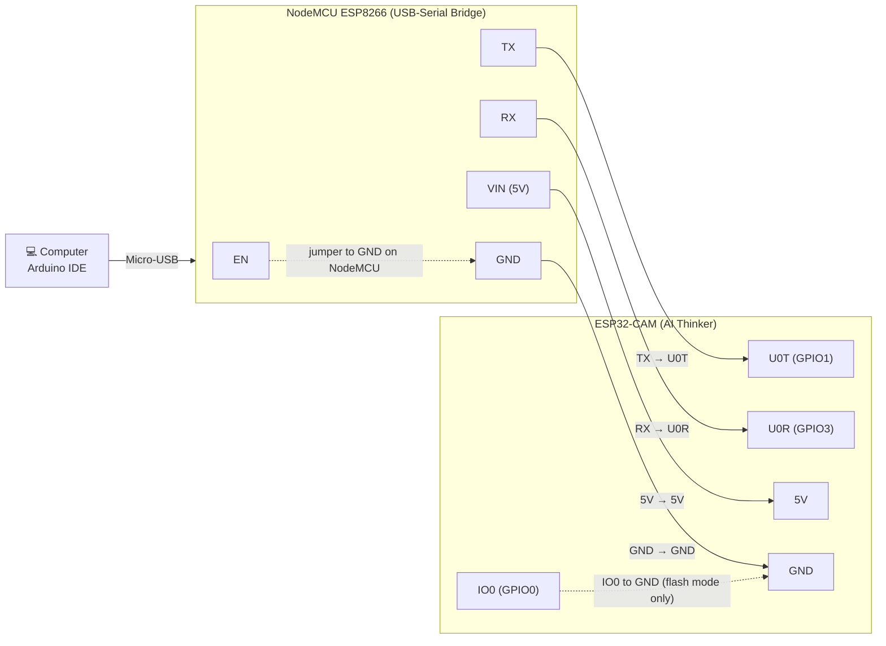

# Programming an ESP32-CAM Using an ESP8266 NodeMCU

The ESP32-CAM (AI Thinker) has **no USB port**, so it needs a USB-to-serial adapter to be programmed. A NodeMCU ESP8266 board already has a USB-to-serial chip (CP2102 or CH340) on it. If we **disable the ESP8266 chip itself** by holding its `EN` pin low, the NodeMCU behaves as a plain USB-to-UART bridge.

---

## 1. What You Need

| Item | Notes |
|------|-------|
| ESP8266MOD NodeMCU WiFi development board | Used only as a USB-serial adapter |
| ESP32-CAM (AI Thinker) | The board you want to program |
| 5 jumper wires (female-female or as per your headers) | 2 more for the EN and GPIO0 links = 7 total |
| Micro-USB data cable | Must be a **data** cable, not charge-only |
| Computer with Arduino IDE | Version 1.8.x or 2.x |

---

## 2. Wiring Table

| # | NodeMCU (ESP8266) | ESP32-CAM | Purpose |
|---|-------------------|-----------|---------|
| 1 | `EN` | `GND` (on the NodeMCU itself) | Disables the ESP8266 chip so it acts as a pure USB-serial bridge |
| 2 | `TX` | `U0T` (GPIO1) | Serial data |
| 3 | `RX` | `U0R` (GPIO3) | Serial data |
| 4 | `VIN` (5 V from USB) | `5V` | Power (recommended) |
| 5 | `GND` | `GND` | Common ground |
| 6 | — | `IO0` → `GND` | Puts ESP32-CAM into **flash mode** (remove after upload) |

> **Why TX→TX and RX→RX (no crossing)?**
> With the ESP8266 disabled, the NodeMCU's `RX` and `TX` header pins are wired straight to the USB-serial chip. The USB chip's transmit line appears on the header pin labeled `RX`, so it must go to the ESP32-CAM's receive pin `U0R`. That is why the connections are "straight" instead of crossed.

> **Power note:** The ESP32-CAM can draw 200–300+ mA (more when Wi-Fi and camera are on). The NodeMCU `3V3` pin is often too weak and causes brown-outs / random resets. Using `VIN` (5 V) → ESP32-CAM `5V` is more reliable. **Never connect 5 V to the ESP32-CAM `3V3` pin.**

---

## 3. Wiring Diagram

### 3.1 Block / Connection Diagram (Mermaid)



### 3.2 ASCII Diagram (works everywhere)

```
        COMPUTER (Arduino IDE)
               |
          Micro-USB cable
               |
   +-----------------------------+                +-----------------------------+
   |   NodeMCU ESP8266           |                |   ESP32-CAM (AI Thinker)    |
   |   (used as USB-Serial)      |                |                             |
   |                             |                |                             |
   |   EN  ---+                  |                |                             |
   |          |  (jumper)        |                |                             |
   |   GND ---+------------------+----------------+--- GND ---+                 |
   |                             |                |           | (jumper,        |
   |   TX  ----------------------+----------------+--- U0T     |  flash mode     |
   |                             |                |           |  only)          |
   |   RX  ----------------------+----------------+--- U0R     |                 |
   |                             |                |           |                 |
   |   VIN (5V) -----------------+----------------+--- 5V      |                 |
   |                             |                |           |                 |
   |                             |                |   IO0  ---+                 |
   +-----------------------------+                +-----------------------------+
```

### 3.3 Pin-to-Pin Cheat Sheet

```
NodeMCU  EN   ───►  NodeMCU GND      (same board, disables ESP8266)
NodeMCU  TX   ───►  ESP32-CAM U0T
NodeMCU  RX   ───►  ESP32-CAM U0R
NodeMCU  VIN  ───►  ESP32-CAM 5V
NodeMCU  GND  ───►  ESP32-CAM GND
ESP32-CAM IO0 ───►  ESP32-CAM GND    (only while uploading)
```

---

## 4. Software Setup (Arduino IDE)

### Step 1 – Install ESP32 board support
1. Open **File → Preferences**.
2. In **Additional Boards Manager URLs** add:
   ```
   https://raw.githubusercontent.com/espressif/arduino-esp32/gh-pages/package_esp32_index.json
   ```
3. Go to **Tools → Board → Boards Manager**, search **esp32**, and install **"esp32 by Espressif Systems"**.

### Step 2 – Select board and settings
| Setting | Value |
|---------|-------|
| Board | **AI Thinker ESP32-CAM** |
| Partition Scheme | **Huge APP (3MB No OTA / 1MB SPIFFS)** |
| Upload Speed | 115200 (use this if you see upload errors) |
| Port | The COM port of your NodeMCU (check Device Manager if unsure) |

> If no COM port appears, install the driver for your NodeMCU's USB chip: **CP210x** (Silicon Labs) or **CH340**.

---

## 5. Uploading the Code

1. Make sure all wiring from Section 2 is done, **including IO0 → GND**.
2. Plug the NodeMCU into your computer via USB.
3. Open an example: **File → Examples → ESP32 → Camera → CameraWebServer**.
4. In the sketch:
   - Enter your Wi-Fi `ssid` and `password`.
   - Make sure only this line is uncommented (the others commented out):
     ```cpp
     #define CAMERA_MODEL_AI_THINKER // Has PSRAM
     ```
5. Click **Upload**.
6. When the IDE console shows `Connecting........____`, **press the RST button** on the ESP32-CAM once.
7. Wait for **"Hard resetting via RTS pin..."** / **Done uploading**.

---

## 6. Running the Camera

1. **Remove the jumper** between `IO0` and `GND` on the ESP32-CAM.
2. Press the **RST** button on the ESP32-CAM.
3. Open **Tools → Serial Monitor**, set baud rate to **115200**.
4. Press **RST** again if nothing prints. You should see something like:
   ```
   WiFi connected
   Camera Ready! Use 'http://192.168.x.x' to connect
   ```
5. Open that IP address in a browser on the same Wi-Fi network and click **Start Stream**.

---

## 7. Troubleshooting

| Problem | Likely Cause | Fix |
|---------|--------------|-----|
| `Failed to connect to ESP32: Wrong boot mode detected` / `Timed out waiting for packet header` | IO0 not grounded, or RST not pressed | Confirm IO0→GND, then press RST when "Connecting..." appears |
| No COM port shown | Charge-only cable or missing driver | Use a data cable; install CP210x/CH340 driver |
| Upload starts, then fails midway | Weak power | Use `VIN`→`5V`, shorter wires, or an external 5 V supply (share the GND) |
| Garbled text in Serial Monitor | Wrong baud rate | Set to 115200 |
| Nothing in Serial Monitor after upload | IO0 still grounded | Remove the IO0–GND jumper, then press RST |
| `Brownout detector was triggered` | Insufficient power | Use a stronger 5 V supply; add a 100–470 µF capacitor across 5V and GND |
| `Camera init failed` | Wrong camera model or loose camera ribbon | Select `CAMERA_MODEL_AI_THINKER`; reseat the camera ribbon cable |
| Still can't connect | ESP8266 is still active | Verify `EN` is firmly connected to `GND` on the NodeMCU |
| Sketch too big error | Wrong partition scheme | Choose **Huge APP (3MB No OTA/1MB SPIFFS)** |

---

## 8. Quick Checklist

- [ ] NodeMCU `EN` → NodeMCU `GND`
- [ ] NodeMCU `TX` → ESP32-CAM `U0T`
- [ ] NodeMCU `RX` → ESP32-CAM `U0R`
- [ ] NodeMCU `VIN` → ESP32-CAM `5V`
- [ ] NodeMCU `GND` → ESP32-CAM `GND`
- [ ] ESP32-CAM `IO0` → `GND` (for upload only)
- [ ] Board: AI Thinker ESP32-CAM, Partition: Huge APP
- [ ] Correct COM port selected
- [ ] Press RST when "Connecting..." appears
- [ ] **Remove IO0–GND jumper** and press RST to run the program

---

## 9. Safety Notes

- ESP32-CAM GPIO pins are **3.3 V logic**. The NodeMCU's TX/RX are also 3.3 V, so direct connection is safe.
- Do **not** feed 5 V into the ESP32-CAM `3V3` pin.
- Always disconnect USB before changing wires.
